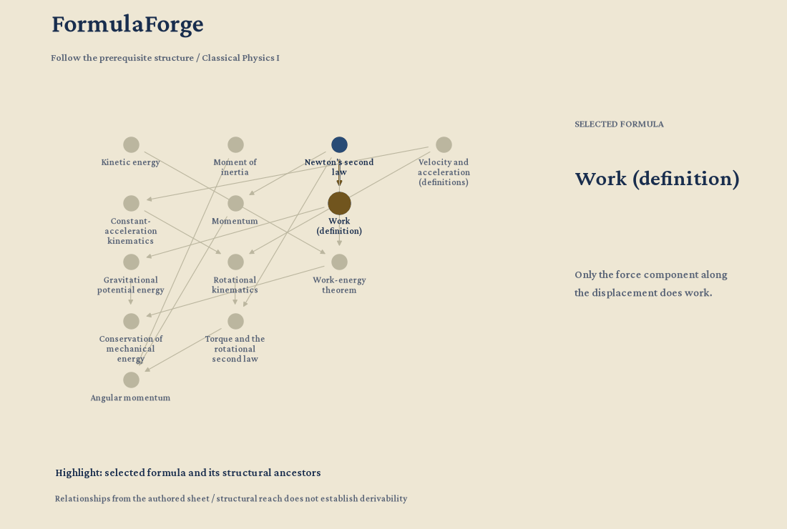
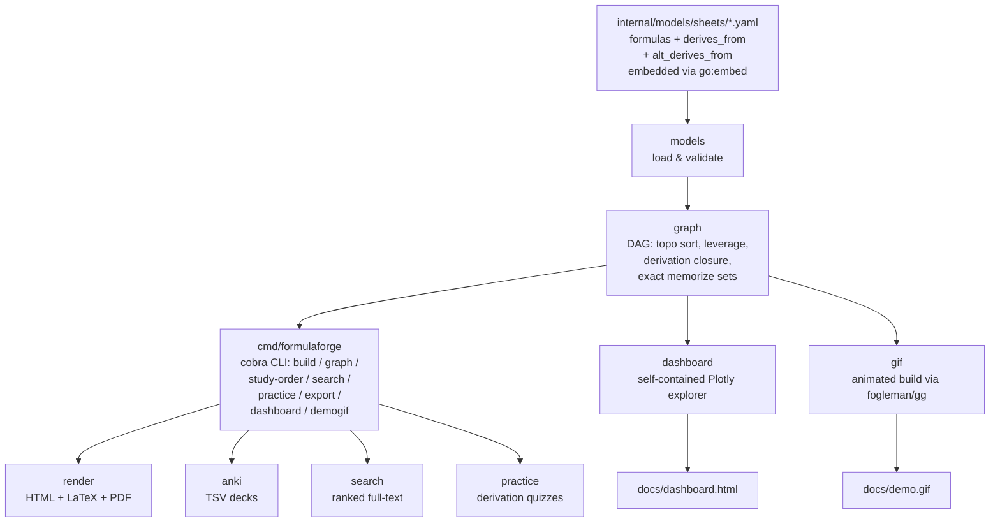

# formulaforge

[](https://github.com/FaiyazEnayet/formulaforge)
[](go.mod)
[](internal/models/sheets/)
[](LICENSE)

Every STEM student builds a formula sheet before each exam. formulaforge is the tool that makes the sheet *smart*.

Write your sheet in YAML + LaTeX. formulaforge renders it to a beautiful printable page. Underneath it builds the **dependency graph**: which formulas derive from which. That graph tells you the optimal study order, which formulas the most others build on, and the smallest set you actually need to memorize. This is the Go rewrite: one static binary, no runtime to install.

## Live interactive demo

[](https://faiyazenayet.github.io/formulaforge/docs/dashboard.html)

**[Open the interactive dashboard](https://faiyazenayet.github.io/formulaforge/docs/dashboard.html).** Explore the dependency graph for nine real courses, click any formula to trace its derivation chain, and watch the minimum-memorize set light up.

## What it does

- **Write sheets in YAML + LaTeX.** One file per course, embedded in the binary. Render to a clean printable page with KaTeX math.
- **Dependency graph.** Declare what each formula builds on. formulaforge checks the graph is a DAG, then topologically sorts it into study waves: learn wave 1 first, derive the rest.
- **Leverage ranking.** Counts how many formulas list each formula as a (transitive) prerequisite. Study the high-leverage ones first. Newton's second law is a prerequisite for 35 others in PHY 131.
- **Minimum-memorize set.** Exact: the root formulas you have not learned yet. Everything else derives from them, so no smaller set works. PHY 131 needs 9 memorized out of 51.
- **Full-text search.** Search across all sheets by name, topic, tag, or description, with sensible ranking.
- **Practice mode.** Quizzes you on derivations: name the prerequisites, order pairs of formulas, or self-test recall. Seeded, so quizzes are reproducible.
- **Exports.** Printable HTML, compilable LaTeX (`.tex`), paginated PDF, and Anki-importable TSV with MathJax cards.
- **Dashboard and demo GIF.** Both generate from one command each. The dashboard is a single self-contained HTML file with plotly.js inlined.

## Quickstart

```bash
go build -o formulaforge ./cmd/formulaforge

formulaforge sheets
formulaforge build phy131 -o phy131.html
formulaforge graph phy131
formulaforge study-order ams261
formulaforge search "induction"
formulaforge practice cse213 --mode derive --n 10
formulaforge export psy103 --format tex -o psy103.tex
formulaforge export phy131 --format anki -o phy131.tsv
formulaforge dashboard -o docs/dashboard.html
formulaforge demogif -o docs/demo.gif
```

## The graph engine

The dependency graph is the whole point. An edge A → B means "B derives from A, so learn A first." On top of that:

- **Topological sort** (Kahn's algorithm) produces the study order, grouped into waves. No formula appears before its prerequisites. Ties break deterministically by id.
- **Leverage** = number of transitive dependents. Newton's second law is a prerequisite for 35 other formulas in PHY 131. Partial derivatives for 11 in AMS 261. The mean for 17 in PSY 103.
- **Minimum-memorize set** = every root formula you do not already know. A formula counts as known when you memorize it, already know it, or can derive it — and deriving takes *all* of one derivation path's prerequisites, not just one. Formulas may declare alternative derivation paths (`alt_derives_from`). For exam prep, `graph --target` finds the exact smallest set that derives just your target formulas. The dashboard coverage curve is a greedy heuristic: each step memorizes the formula that makes the most new formulas derivable.

Example output from `formulaforge graph phy131`:

```
PHY 131 Classical Physics I
  formulas:   51
  derivations:66
  study waves:7 (longest chain: 6)
  roots: 9, leaves: 23
  highest leverage (unlocks the most):
    Newton's second law: 35
    Work (definition): 20
    Kinetic energy: 10
    Velocity and acceleration (definitions): 9
    Spring potential energy and Hooke's law: 8
  minimum memorize set (9):
    - Center of mass
    - Continuity equation
    - Density
    - Newton's law of gravitation
    - Kinetic energy
    - Moment of inertia
    - Newton's second law
    - Temperature scales
    - Velocity and acceleration (definitions)
```

## Seeded sheets

Nine complete, hand-checked sheets ship inside the binary. 294 formulas, 303 derivation edges, every one validated:

| Sheet | Course | Formulas | Min. memorize |
|-------|--------|----------|---------------|
| `ams151` | Applied Calculus I | 25 | 2 |
| `ams161` | Applied Calculus II | 26 | 7 |
| `ams210` | Applied Linear Algebra | 30 | 8 |
| `ams261` | Calculus III | 45 | 5 |
| `phy131` | Classical Physics I | 51 | 9 |
| `cse113` | Foundations of Computer Science I | 32 | 8 |
| `cse213` | Foundations of Computer Science II | 34 | 13 |
| `cse214` | Data Structures | 29 | 12 |
| `psy103` | Introduction to Psychology | 22 | 5 |

AMS 151 runs from limits through the Fundamental Theorem. AMS 161 covers integration techniques, series convergence tests, and parametric and polar curves. AMS 210 is vectors, matrices, eigenvalues, and least squares. AMS 261 runs from sequences and series through vectors, partial derivatives, and Stokes' and the divergence theorem. PHY 131 covers the full classical arc: kinematics through statics, fluids, oscillations, waves, sound, and thermodynamics. CSE 113 is the logic toolkit: propositional and predicate logic, number theory and proof methods, induction, set theory, and functions, built from the actual homework sets. CSE 213 follows the actual course syllabus: counting and probability, graphs and trees, regular expressions and finite-state automata, on a small logic foundation. CSE 214 covers algorithm analysis, recurrences, linked structures, trees, heaps, hashing, sorting bounds, and graph algorithms. PSY 103 covers the quantitative core of intro psych: descriptive statistics, z-scores, correlation and regression, and inferential stats.

## Architecture



## Project layout

```
formulaforge/
  cmd/formulaforge/   cobra CLI
  internal/models/    sheets (embedded YAML), load & validate
  internal/graph/     DAG: topo sort, leverage, derivation closure, exact memorize sets
  internal/search/    ranked full-text search
  internal/practice/  derivation quizzes
  internal/render/    HTML + LaTeX + PDF export
  internal/anki/      Anki TSV export
  internal/dashboard/ self-contained Plotly dashboard generator
  internal/gif/       demo GIF renderer
  docs/               dashboard.html, demo.gif
```

Run the tests: `go test ./...` (69 tests). Regenerate the artifacts: `formulaforge dashboard` and `formulaforge demogif`.

## Limitations

- The full-sheet minimum-memorize set is exact: it is the set of root formulas outside your prior knowledge. The target-set solver (`graph --target`) is exact via branch and bound, which is exponential in the worst case — very large target lists on dense graphs can be slow. The dashboard coverage curve is only a greedy heuristic.
- The PDF export is a clean reading copy: math appears as LaTeX source in monospace because gofpdf has no TeX engine. For typeset math, use the `.tex` export and run `pdflatex`.
- The Anki export is a TSV you import via File > Import, not a ready-made `.apkg`. Cards use `\[ \]` delimiters so Anki's built-in MathJax renders them.
- The dashboard inlines plotly.js so it works offline, but formula detail rendering loads KaTeX from a CDN. No internet, no pretty math in the detail panel.
- Quiz question order uses Go's `math/rand`, so sequences differ from the Python version's. Same seed still gives the same quiz every time.
