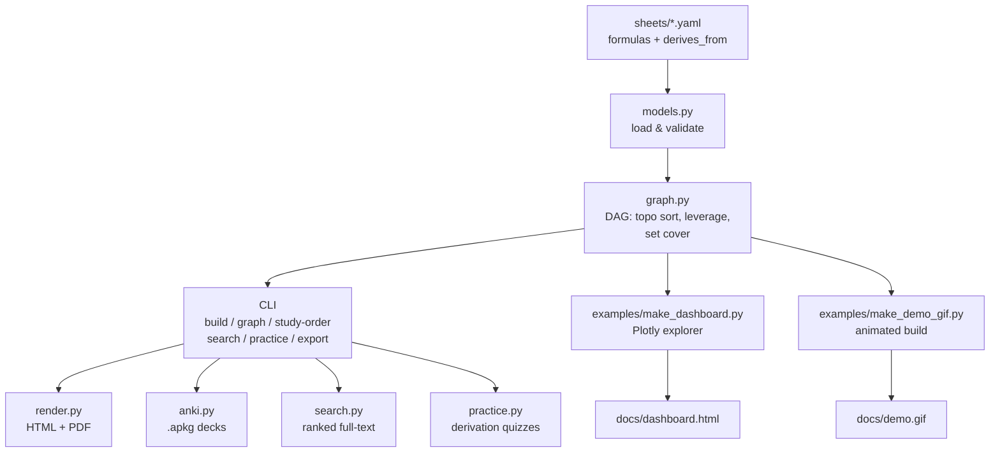

# formulaforge

[](tests/)
[](pyproject.toml)
[](sheets/)
[](LICENSE)

Every STEM student builds a formula sheet before each exam. formulaforge is the tool that makes the sheet *smart*.

Write your sheet in Markdown + LaTeX. formulaforge renders it to a beautiful printable page. Underneath it builds the **dependency graph**: which formulas derive from which. That graph tells you the optimal study order, which formulas unlock the most others, and the smallest set you actually need to memorize.

## Live interactive demo

[](https://faiyazenayet.github.io/formulaforge/docs/dashboard.html)

**[Open the interactive dashboard](https://faiyazenayet.github.io/formulaforge/docs/dashboard.html).** Explore the dependency graph for four real courses, click any formula to trace its derivation chain, and see the minimum-memorize set light up.

## What it does

- **Write sheets in Markdown + LaTeX.** One YAML file per course. Render to a clean printable page with KaTeX math.
- **Dependency graph.** Declare what each formula builds on. formulaforge checks the graph is a DAG, then topologically sorts it into study waves: learn wave 1 first, derive the rest.
- **Leverage ranking.** Counts how many formulas each formula transitively unlocks. Study the high-leverage ones first.
- **Minimum-memorize set.** Greedy set cover over the graph: the smallest set of formulas from which everything else can be derived. PHY 131 needs just 6 memorized out of 27.
- **Full-text search.** Search across all sheets by name, topic, tag, or description.
- **Practice mode.** Quizzes you on derivations: name the prerequisites, order pairs of formulas, or self-test recall.
- **Exports.** Printable HTML, paginated PDF with rendered math, and Anki decks (.apkg) with MathJax cards.

## Quickstart

```bash
pip install -e .
formulaforge sheets
formulaforge build phy131 -o phy131.html
formulaforge graph phy131
formulaforge study-order ams261
formulaforge search "eigenvalue"
formulaforge practice mat203 --mode derive --n 10
formulaforge export che131 --format pdf -o che131.pdf
formulaforge export phy131 --format anki -o phy131.apkg
```

## The graph engine

The dependency graph is the whole point. An edge A → B means "B derives from A, so learn A first." On top of that:

- **Topological sort** (Kahn's algorithm) produces the study order, grouped into waves. No formula appears before its prerequisites.
- **Leverage** = number of transitive dependents. Newton's second law unlocks 17 other formulas in PHY 131. Partial derivatives unlock 11 in AMS 261.
- **Minimum-memorize set** = greedy set cover where each formula covers itself plus everything it unlocks. The dashboard shows the coverage curve: how much of the sheet each additional memorized formula buys you.

Example output from `formulaforge graph phy131`:

```
PHY 131 Classical Physics I
  formulas:   27
  derivations:34
  study waves:5 (longest chain: 4)
  roots: 6, leaves: 8
  highest leverage (unlocks the most):
    Newton's second law: 17
    Work (definition): 8
    Velocity and acceleration (definitions): 7
    ...
  minimum memorize set (6):
    - Newton's second law
    - Velocity and acceleration (definitions)
    - Moment of inertia
    - Kinetic energy
    - Newton's law of gravitation
    - Center of mass
```

## Seeded sheets

Four complete, hand-checked sheets ship with the tool. 99 formulas, 115 derivation edges, every one verified:

| Sheet | Course | Formulas | Min. memorize |
|-------|--------|----------|---------------|
| `ams261` | Calculus III | 21 | 3 |
| `phy131` | Classical Physics I | 27 | 6 |
| `mat203` | Linear Algebra | 30 | 8 |
| `che131` | General Chemistry I | 21 | 8 |

AMS 261 covers partial derivatives through Stokes' and the divergence theorem. PHY 131 runs from kinematics to angular momentum. MAT 203 goes from matrix multiplication to the spectral theorem. CHE 131 covers stoichiometry, gas laws, thermochemistry, and atomic structure.

## Architecture



## Project layout

```
formulaforge/
  src/formulaforge/   models, graph, search, render, anki, practice, cli
  sheets/             ams261, phy131, mat203, che131 (YAML)
  tests/              46 pytest tests
  examples/           dashboard + GIF generators (reproducible)
  docs/               dashboard.html, demo.gif
```

Run the tests: `pytest tests/`. Regenerate the artifacts: `python examples/make_dashboard.py` and `python examples/make_demo_gif.py`.

## Limitations

- The minimum-memorize set uses greedy set cover, which is an approximation (within a logarithmic factor of optimal). For these small graphs it is exact or near-exact, but it is not guaranteed optimal.
- "Derives from" edges are pedagogical, not formal proofs. Two instructors might draw the graph slightly differently.
- PDF math rendering uses matplotlib's mathtext, so a few LaTeX constructs are simplified there (e.g. matrices become bracket notation). The HTML export renders full LaTeX via KaTeX.
- Anki cards rely on Anki's built-in MathJax; very old Anki versions may not render the math.
- The seeded sheets cover four courses. Your course is probably not among them yet. Adding one is a single YAML file.
