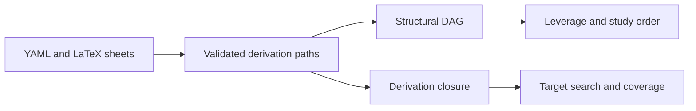
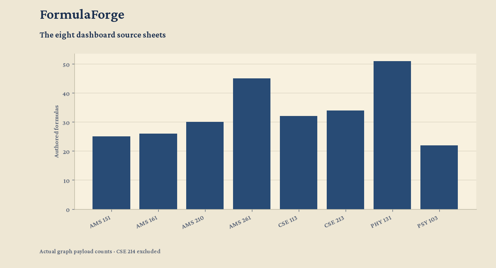

<p align="center"></p>

<h1 align="center">FormulaForge</h1>

<p align="center">
  <a href="https://github.com/FaiyazEnayet/formulaforge/actions/workflows/ci.yml"></a>
  
  
  
</p>

<p align="center">
  <a href="https://faiyazenayet.github.io/formulaforge/docs/dashboard.html"></a>
  <a href="#method"></a>
  <a href="#run-locally"></a>
</p>

FormulaForge turns a formula sheet into a searchable dependency model. It shows which prerequisites support a result, what is already derivable and which concepts are useful to learn next.


<p align="center"><a href="https://faiyazenayet.github.io/formulaforge/docs/dashboard.html"></a></p>


A dependency view is useful for planning revision only when its relationships are interpreted correctly. Selecting a formula reveals the concepts that support it, while search and topic filters keep a large sheet navigable. Structural reach, valid derivability and an optimal memorization strategy answer different questions and should be assessed separately.

## Explore

- Search and filter eight dashboard sheets, then select a formula to inspect its prerequisites.
- Explore structural leverage separately from valid derivability.
- Use the coverage view as a greedy study heuristic, not an exact optimal learning plan.

## Method

Sheets declare formulas and derivation paths in YAML. A path requires all its prerequisites; alternative paths are OR choices. The graph supports structural leverage, derivation closure, study order and target-set search.

## Evidence at a glance

| Scope | Recorded result or contract |
| :--- | :--- |
| Dashboard scope | Eight sheets |
| Derivation semantics | AND within each path; OR across alternative paths |
| Coverage curve | Engine-generated greedy heuristic; PHY 131 coverage at K=1 is 0.3922, and at K=6 is 0.9216 |
| Target-set solver | Exact branch and bound; exponential worst-case complexity |

The PHY 131 showcase in `scripts/showcase-data.json` is exported by the Go engine. The dashboard computes its sheet payload through the same derivation closure, so coverage reflects the conjunctive prerequisite rules rather than a manually maintained series.

## Updating this project

Dashboard source language: **Go**. Generator: `internal/dashboard/dashboard.go via the Go CLI`. The local interactive output is `docs/dashboard.html`.

## Run locally


```sh
go build -o formulaforge ./cmd/formulaforge
go test ./...
./formulaforge graph phy131
./formulaforge dashboard -o docs/dashboard.html
```

## Technical design

A formula can declare one or more derivation paths. Every prerequisite in a path is required; satisfying any alternative path is sufficient. The graph also stores the union of prerequisites for structural topology and leverage. This distinction prevents a reachable descendant from being mislabeled as immediately derivable.



## Evaluation protocol

Full-sheet and target-set questions are different. A full-sheet memorize set is based on roots outside prior knowledge. The target-set solver uses exact branch and bound. The dashboard coverage curve uses a greedy sequence and should be described as a heuristic, even though its closure calculation respects derivation semantics.



The dashboard is an exploration tool for authored mathematical relationships. It does not infer new theorems or certify the completeness of a course syllabus. The eight source sheets retain their actual formulas and dependencies.

## Code and data

`internal/models/` loads embedded sheets. `internal/graph/` owns dependency semantics and graph algorithms. `internal/search/` handles search. `internal/dashboard/` generates the HTML output.


## Limitations

- Structural descendants are not automatically derivable from one memorized node.
- Dense target searches need a time or node budget for predictable response times.
- The PDF export is a reading copy; use the LaTeX export for typeset mathematics.

## License

[MIT](LICENSE). Third-party datasets, libraries and fonts retain their own terms.
